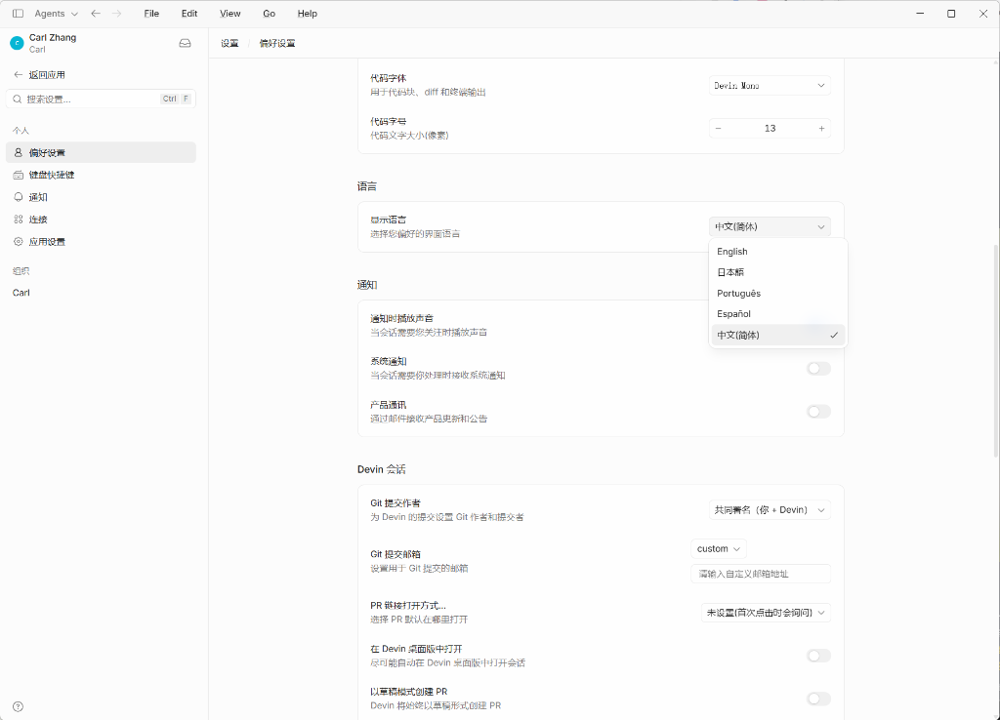

# Devin Agent 界面简体中文汉化包

非官方简体中文语言包，为 **Devin Desktop**（Windows 桌面端）提供尽可能完整的界面中文翻译，覆盖双层本地化体系：

- **Webapp 层**（i18next 字典）：主界面翻译资源 **20,194 条**（`zh-CN-translation.js`）+ Review 界面 **1,160 条**（`zh-CN-review.js`），与官方日语包 key 集完全对齐
- **Workbench 内核层**（NLS 消息数组）：**21,210 条全部汉化**（`nls.messages.zh.json` / `nls.messages.zh.js`）——覆盖顶部菜单栏、命令面板、编辑器界面、通知、对话框等所有 VS Code 系 UI 文案；其中 20,014 条来自官方 VS Code 简体中文语言包，1,196 条 Devin 特有字符串为手工补译
- 一键安装 / 一键还原，自动备份原始文件（`.zhorig`）

## 效果截图

设置页「显示语言」下拉框中新增并选中「中文(简体)」：



命令面板语言选择器：


侧边栏导航全面中文化：


主界面页面中文化（自动化页示例）：


## 使用方法

1. 下载本仓库（或 [Releases](../../releases) 中的 zip 包）并解压到任意位置（桌面、U 盘均可）。
2. 双击运行 **`一键汉化.bat`**，脚本会自动：
   1. 探测 Devin 安装目录
   2. 复制 `zh-CN-translation.js` / `zh-CN-review.js` 到 assets 目录
   3. 用 `nls.messages.zh.json` / `nls.messages.zh.js` 替换 `out\` 下的 workbench 内核消息文件（先备份 `.zhorig`）
   4. 在入口 bundle 的语言列表中注册 `zh`（中文(简体)）
   5. 补丁 index bundle：`zh` 语言跳过云端保存（服务端语言枚举不含 `zh`），改用 `localStorage` 持久化
3. **完全退出并重启 Devin**（关闭所有窗口重新打开）。
   - 注意：顶部菜单栏（文件/编辑/查看/转到/帮助）由 Electron 主进程在启动时读取 NLS 文件，`Developer: Reload Window` 只重载渲染进程、不会刷新菜单，必须整体重启。
4. 在命令面板执行 `配置显示语言 / Configure Display Language`，选择 **中文(简体)**。

自动探测失败时手动指定 assets 目录：

```powershell
powershell -File apply-zh.ps1 -AssetsDir "D:\...\devin-webapp-host\assets"
```

## 还原英文

双击 **`还原英文.bat`**：将 assets 与 `out\` 下的 `.zhorig` 备份盖回原文件并删除 `zh-CN-*.js` chunk，重启 Devin 即恢复出厂状态。

## 覆盖范围

| 范围 | 状态 |
| --- | --- |
| Webapp 页面、设置、侧边栏、会话界面 | ✅ 全量（与官方 ja 包对齐） |
| 顶部菜单栏及下拉菜单 | ✅（需完全重启 Devin） |
| 命令面板命令名 | ✅ |
| 编辑器、终端、通知、对话框等 workbench UI | ✅ |
| 专有名词 `Devin` / `Agents`、键名 `Ctrl`/`Shift` 等 | 刻意保留英文 |
| 服务端返回内容（会话标题、报错信息、模型名等） | 无法汉化 |

## 特性

- **幂等**：重复运行自动跳过已补丁部分，不会重复写入
- **自动备份**：首次补丁前把原文件保存为 `*.zhorig`
- **抗更新**：补丁按代码结构定位（不依赖文件哈希），Devin 升级覆盖文件后重跑一次 `一键汉化.bat` 即可恢复
- **任意位置运行**：脚本以自身所在目录定位资源，无需放进安装目录
- **安装路径自动探测**，优先级：
  1. `-AssetsDir` 手动指定
  2. 常见安装目录（`E:\`、`%LOCALAPPDATA%\Programs\`、`Program Files`、`D:\`、`C:\`）
  3. 正在运行的 `Devin.exe` 进程路径反推
  4. 注册表卸载条目的安装位置

## 工作原理

Devin Desktop 有两套互不相同的本地化体系，本补丁两层都覆盖：

**1. Webapp 层**（`resources\app\out\vs\workbench\devin-webapp-host\assets`，i18next 字典）

1. **拷贝语言 chunk**：把两个 `zh-CN-*.js` 翻译资源放入 assets，并追加到 `entry-host-editor-mode-menu-*.js` 的 `m.f` 依赖表与 `__vite__mapDeps`。
2. **注册语言项**：克隆语言列表中最后一个条目改写为 `{code:'zh', label:'中文(简体)'}`。
3. **写路径补丁**：`PUT users/ui-language` 对 `zh` 直接本地返回（服务端枚举不认 `zh`，否则会保存失败）。
4. **读路径补丁**：`GET users/ui-language` 对 `zh` 优先读 `localStorage['devin-language']`，避免启动时被服务端返回的 `en` 覆盖。

**2. Workbench 内核层**（`resources\app\out\nls.messages.json` / `nls.messages.js`，VS Code NLS 消息数组）

Devin 基于 VS Code fork，菜单栏/命令面板/编辑器等字符串按**索引**从全局 NLS 消息数组取值（如 `Ue(1831,"File")`）。补丁用等长中文数组（21,210 条，索引一一对应）整体替换该文件：

- 渲染进程在窗口加载时读取 `nls.messages.js` → 命令面板、编辑器 UI 变中文
- Electron 主进程在启动时读取 `nls.messages.json` 构建应用菜单 → 顶部菜单栏变中文（需完全重启）

## 文件清单

| 文件 | 说明 |
| --- | --- |
| `一键汉化.bat` | 应用汉化（双击） |
| `还原英文.bat` | 还原原始英文（双击） |
| `apply-zh.ps1` | 汉化补丁脚本 |
| `restore-zh.ps1` | 还原脚本 |
| `zh-CN-translation.js` | Webapp 主界面中文资源（20,194 条） |
| `zh-CN-review.js` | Webapp Review 界面中文资源（1,160 条） |
| `nls.messages.zh.json` | Workbench 内核中文消息数组（21,210 条，JSON） |
| `nls.messages.zh.js` | 同上（JS 包装版，供渲染进程加载） |
| `README.txt` | 包内说明 |

## 注意事项

- 本项目为第三方非官方补丁，与 Cognition / Devin 官方无关。
- 补丁会修改本地安装文件，使用前请知悉风险；`.zhorig` 备份可完全还原。
- Devin 版本更新后若入口 bundle 结构变化，补丁脚本可能提示「版本可能已变化」，需要更新补丁逻辑。
- Devin 版本更新后 NLS 消息数组可能增删条目，替换文件若与新版索引错位会导致文案错乱——届时请先用 `还原英文.bat` 还原，等待语言包更新。
- 翻译文件较大（约 1 MB），首次加载语言时可能稍慢。
